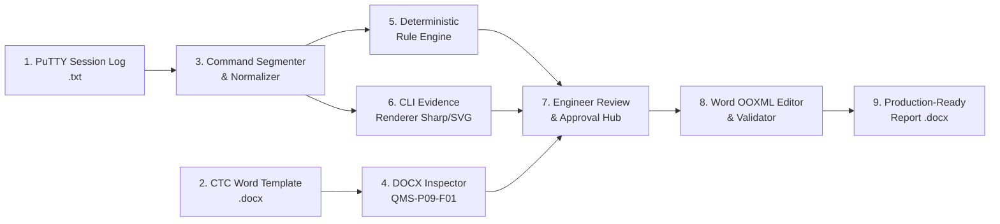

# CTC PM Automation Tool

[](https://nextjs.org/)
[](https://react.dev/)
[](https://www.typescriptlang.org/)
[](https://tailwindcss.com/)
[](https://www.prisma.io/)
[](https://www.sqlite.org/)
[](https://vitest.dev/)

> **Local-First Preventive Maintenance (PM) Report Automation** for CTC Global's Network Security Practice. Automates PuTTY session log segmentation, deterministic firewall checklist evaluation, CLI terminal evidence generation, and in-place Microsoft Word (`.docx`) report modification.

---

## 1. Executive Summary

Preventive Maintenance (PM) is a critical contractual service executed by CTC Global Network Security engineers across enterprise client firewalls. Previously, engineers spent hours manually copying CLI command outputs from PuTTY sessions, pasting text into terminal screenshot generators, taking manual screenshots, manually checking health values, and copy-pasting remarks into Microsoft Word reports.

**CTC PM Automation Tool** eliminates this manual overhead through a local-first, offline-capable application:
- **No Cloud Dependency / Local-First**: Operates strictly on `localhost` with local SQLite and disk storage. No confidential customer session logs, IP addresses, or network configurations leave the engineer's workstation.
- **Cryptographic Auditability**: Calculates SHA-256 checksums on all ingested PuTTY session logs and Word templates, preserving originals immutably.
- **Deterministic Evaluation**: Replaces subjective evaluation with transparent, auditable rules mapped to CTC's **QMS-P09-F01 v1.1** standard.
- **Non-Destructive OOXML Editing**: Opens the authentic CTC Word document as a zip archive and performs targeted modifications to SDT checkboxes (`☒`/`☐`), remarks cells (in CTC Blue typography `#0070C0`), and appendix terminal images without destroying author credentials, margins, headers, or customer survey tables.

---

## 2. End-to-End Workflow



1. **Session Scope Setup**: Engineer creates a PM session, specifying client name, PM date, and target firewalls (supports Standalone, Primary/Secondary HA clusters, and DR sites).
2. **File Ingestion**: Ingests PuTTY session logs (`.txt`) and authentic CTC Word reports (`.docx`). Computes SHA-256 hashes immediately.
3. **Log Normalization & Segmentation**: Strips ANSI escape sequences, handles CRLF/LF line endings, eliminates pagination prompts (`--More--`), and segments commands using FortiOS prompt signatures.
4. **Deterministic Rule Evaluation**: Applies vendor validation rules across 21 FortiGate checklist items (CPU, Memory, HA synchronization, disk health, licensing contracts, firmware, routing tables, VPN tunnels).
5. **CLI Evidence Image Generation**: Converts verified CLI outputs into appendix-ready terminal screenshots using SVG + Sharp with automatic line wrapping, multi-page pagination, and secret redaction.
6. **Engineer Review & Approval**: Interactive side-by-side comparison table (Original Word Report vs. Proposed Telemetry Findings). Engineers can approve all passing checks, override statuses, edit final remarks in-place, and justify exceptions.
7. **Report Export**: Modifies the Word package in-place and exports a versioned `.docx` document (`PM_Report_<Customer>_<Device>_v1.docx`) while preserving sign-off Table 0 and customer survey Table 1.

---

## 3. Technology Stack

| Layer | Technology | Purpose |
| :--- | :--- | :--- |
| **Framework** | **Next.js 16 (App Router, Turbopack)** | Fullstack web application with Node.js runtime |
| **Language** | **TypeScript 5 (Strict Mode)** | End-to-end type safety with zero runtime type leaks |
| **UI Components** | **React 19 + Tailwind CSS v4 + Lucide** | High-contrast, dark-mode cybersecurity engineer workspace |
| **Persistence** | **SQLite + Prisma ORM** | Local-first relational storage for sessions, devices, and decisions |
| **File Storage** | **Local Filesystem** | SHA-256 checksummed file storage under local workspace |
| **Image Engine** | **Sharp + SVG** | High-fidelity CLI terminal screenshot rendering and pagination |
| **DOCX Engine** | **JSZip + Fast-XML-Parser** | Non-destructive OpenXML manipulation and relationship tracking |
| **Validation** | **Zod** | Schema validation for API payloads, parser outputs, and decisions |
| **Testing** | **Vitest 3** | Fast unit and integration test runner with single-fork execution |

---

## 4. Project Structure

```text
cli-report-generator/
├── prisma/
│   ├── schema.prisma              # Database schema (PMSession, Device, ReviewDecision, etc.)
│   └── migrations/                # SQLite migrations
├── src/
│   ├── app/                       # Next.js App Router
│   │   ├── api/sessions/          # RESTful endpoints (evaluate, review, export, evidence)
│   │   ├── sessions/              # Pages: /sessions/new, /sessions/[id], /sessions/[id]/review
│   │   ├── globals.css            # Obsidian dark theme and Tailwind v4 setup
│   │   ├── layout.tsx             # Root layout with persistent navigation
│   │   └── page.tsx               # Preventive Maintenance dashboard
│   ├── components/
│   │   ├── checklist/             # CLI checklist table, commands, mapping matrix
│   │   ├── evidence/              # Terminal screenshot gallery and preview modal
│   │   ├── log-importer/          # PuTTY log segmentation and device mapper UI
│   │   ├── report/                # Review table, export modal, justification dialog
│   │   ├── session/               # Session workspace, device manager, files list
│   │   └── ui/                    # Reusable primitives (Card, Badge, Button, Dialog)
│   ├── core/
│   │   ├── checks/                # Rule engine, normalized result definitions
│   │   ├── cli/                   # Log normalizer, prompt recognition, command segmenter
│   │   ├── document/              # DOCX inspector, OOXML editor, validator, rels manager
│   │   ├── evidence/              # SVG terminal renderer, multi-page paginator, redaction
│   │   └── review/                # Review service, diff engine, approval contracts
│   ├── lib/
│   │   ├── db/                    # Prisma client singleton
│   │   └── storage/               # Cryptographic local storage abstraction
│   ├── report-layouts/
│   │   ├── ctc-fortigate-v1_1.ts  # Layout mapping for CTC QMS-P09-F01 v1.1
│   │   └── registry.ts            # Report layout registry
│   └── vendors/
│       ├── fortigate/             # FortiGate commands, parsers, rules, and checklist
│       ├── registry.ts            # Vendor adapter registry
│       └── types.ts               # Multi-vendor adapter contract (VendorAdapter)
└── tests/
    ├── fixtures/                  # Sanitized PuTTY logs and sample Word templates
    ├── integration/               # API & workflow integration tests (10 test suites)
    └── unit/                      # Parsers, rules, editor, and renderer unit tests (13 test suites)
```

---

## 5. Getting Started

### Prerequisites
- **Node.js**: `v18.18.0` or higher (LTS recommended)
- **Package Manager**: `npm` (v9+)

### Installation
```bash
# 1. Clone repository
git clone https://github.com/your-org/cli-report-generator.git
cd cli-report-generator

# 2. Install dependencies
npm install

# 3. Initialize SQLite database via Prisma
npx prisma db push
# or run migrations
npx prisma migrate dev
```

### Running Locally
```bash
# Start Next.js development server
npm run dev
```
Open [http://localhost:3000](http://localhost:3000) in your web browser.

### Running Test Suite
The repository includes a comprehensive unit and integration test suite (123 automated tests):
```bash
# Run all unit and integration tests
npm test

# Run tests in watch mode
npx vitest
```

### Production Build
```bash
# Type check and build optimized bundle
npm run build

# Start production server
npm start
```

---

## 6. Multi-Vendor Architecture & Future Extensibility

The tool strictly decouples **firewall vendor adapters** from the **document engine**:

```text
┌─────────────────────────────────┐       ┌─────────────────────────────────┐
│     Vendor Adapter Interface    │       │     Report Layout Interface     │
│   (commands, parsers, rules)    │       │ (sections, rows, appendix targets)│
└────────────────┬────────────────┘       └────────────────┬────────────────┘
                 │                                         │
        ┌────────▼────────┐                       ┌────────▼────────┐
        │ FortiGate (MVP) │                       │ CTC FortiGate   │
        │ Palo Alto (P10) │                       │     v1.1        │
        │ Check Point     │                       │ CTC Palo Alto   │
        └─────────────────┘                       └─────────────────┘
```

Adding a new vendor (e.g., Palo Alto PAN-OS or Check Point Quantum) **does not require modifying** the document editor, evidence generator, or review UI:
1. Create a directory under `src/vendors/<vendor>/`.
2. Implement the `VendorAdapter` contract defined in [`src/vendors/types.ts`](file:///c:/Users/ziyu.cha-c/Documents/GitHub/cli-report-generator/src/vendors/types.ts).
3. Register the adapter in [`src/vendors/registry.ts`](file:///c:/Users/ziyu.cha-c/Documents/GitHub/cli-report-generator/src/vendors/registry.ts).
4. Register any custom Word template mapping under `src/report-layouts/`.

---

## 7. Security, Privacy & Confidentiality

- **Zero Cloud Leakage**: No telemetry, analytics, or session log data is sent to external cloud APIs or third-party servers.
- **Secret Redaction**: Embedded redaction rules automatically sanitize passwords, pre-shared keys (PSKs), SNMP community strings, and private keys before rendering evidence images.
- **Git Protection**: The `.gitignore` configuration explicitly excludes client report folders (`doc/`, `docs/`) and local storage (`data/`, `*.sqlite`, `*.db`) to protect sensitive customer architectures from accidental commit.

---

## 8. Authors & Practice

- **Developed For**: CTC Global Malaysia — Network Security Practice
- **Standard Operating Procedure**: Preventive Maintenance Reporting (QMS-P09-F01)
